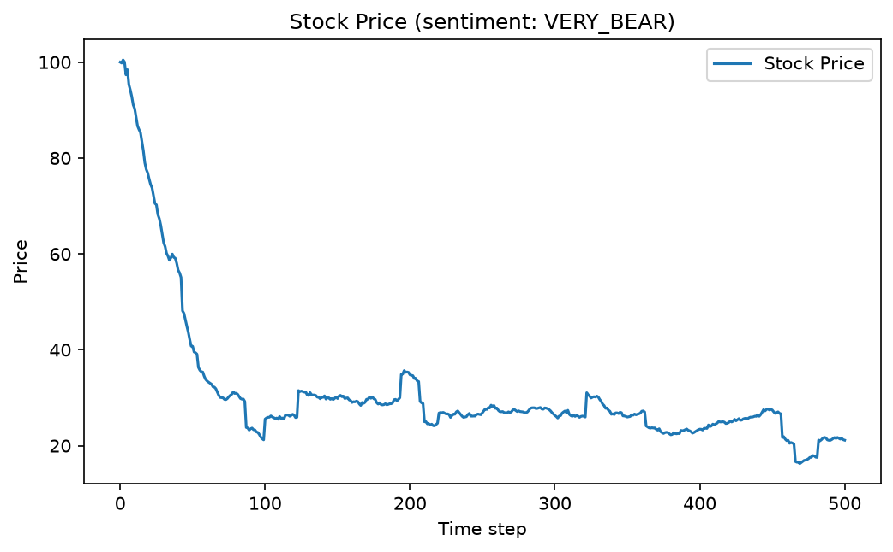
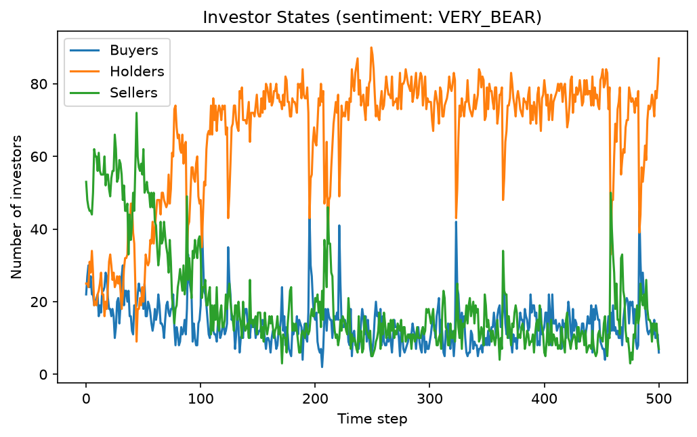

# Stock Rally/Crash Simulator

[](https://github.com/rramboer/stock-simulator/actions/workflows/ci.yml)
[](https://www.python.org/downloads/)
[](LICENSE)
[](https://github.com/astral-sh/ruff)

Stock rally and crash simulator that uses a complex systems Monte Carlo approach to simulate a stock rally or crash based on a parameterized initial sentiment and the introduction of fear-of-missing-out (FOMO) investors and panic buyers and sellers.

## How it works

The market is a population of investors, each holding shares and carrying a sentiment in `[-1, 1]`. Sentiment above `+0.333` makes an investor a buyer, below `-0.333` a seller, and anything in between a holder. Every time step:

1. **Trading** — each investor trades with the next few investors in a randomly shuffled order. Shares only move between a buyer and a seller, in proportion to the average of their sentiments times the seller's holdings, so the total share count is conserved.
2. **Sentiment updates** — each investor then reconsiders:
   - **FOMO**: with probability `--fomo-threshold`, the latest percent price move is added to sentiment, so a big move rapidly converts the crowd.
   - **Panic**: with probability `--panic-prob`, sentiment reverses and damps without external provocation.
   - **Follow the market**: some investors snap toward the configured sentiment skew instead.
3. **Price move** — the price changes with traded volume times aggregate sentiment (scaled by the total float), then multiplied by a noise draw from `[-3, 7)`. The draw's mean of `+2` amplifies the move in whichever direction aggregate sentiment points (accelerating crashes in bearish runs just as it accelerates rallies in bullish ones), while negative draws occasionally flip it. Occasionally (probability `--panic-prob / 8`) an unforeseen market event rescales the price by a random factor in `[0.75, 1.25)`.

The run ends after `--steps` steps or as soon as the price hits the floor at zero.

## Example output

Both example charts were produced with the default very bearish sentiment (`--sentiment VERY_BEAR`).

### Price chart



### Investor breakdown



### Regenerating the example charts

Running the simulator from the repo root rewrites `price_chart.png` and `investor_chart.png` in place:

```sh
uv run stock-simulator --sentiment VERY_BEAR
```

Runs are randomized, so your charts will differ from the committed examples unless you pass `--seed`. Charts are always written headlessly with matplotlib's Agg backend — no display is needed, and no window is opened.

## Installation

Requires Python 3.12+ and [uv](https://docs.astral.sh/uv/). matplotlib is the only runtime dependency.

```sh
git clone https://github.com/rramboer/stock-simulator.git
cd stock-simulator
uv sync
```

## Usage

```sh
uv run stock-simulator [options]
```

A seeded example run:

```console
$ uv run stock-simulator --sentiment VERY_BEAR --seed 42
Current Price: 0.00
Percent Change (DAILY): -100.00%
Percent Change (ALL TIME): -100.00%
Saved charts to price_chart.png and investor_chart.png
```

| Option | Meaning | Default |
| --- | --- | --- |
| `--sentiment` | Initial market sentiment skew: `VERY_BEAR`, `BEARISH`, `NEUTRAL`, `BULLISH`, or `VERY_BULL` (mapped to −1 … 1) | `VERY_BEAR` |
| `--investors` | Number of investors in the market | `100` |
| `--trades` | Trades per investor per time step | `5` |
| `--fomo-threshold` | Susceptibility to FOMO in `(0, 1]`; 0 is none, 1 is maximum | `0.5` |
| `--panic-prob` | Per-step probability that an investor panic trades | `0.2` |
| `--steps` | Maximum number of time steps; stops early if the price hits zero | `500` |
| `--seed` | Random seed for a reproducible run | unseeded |
| `--price-chart` | Output path for the price chart PNG | `price_chart.png` |
| `--investor-chart` | Output path for the investor chart PNG | `investor_chart.png` |
| `--verbose` | Also print end-of-run market statistics (holdings, average sentiment, buyer/holder/seller counts) | off |

Two more constants live in `SimulationConfig` (`src/stock_simulator/simulation.py`) rather than on the CLI: the starting price (`100.0`) and the total number of shares (`100,000`). The simulation is also usable as a library:

```python
import random
from stock_simulator import Simulation, SimulationConfig, SENTIMENT_SKEWS

sim = Simulation(
    SimulationConfig(sentiment_skew=SENTIMENT_SKEWS["BULLISH"]),
    rng=random.Random(42),
)
prices = sim.run(500)
```

## Project structure

- `src/stock_simulator/` — the package: `simulation.py` (the model), `plotting.py` (headless chart rendering), `cli.py` (argparse entry point)
- `tests/` — pytest suite (model invariants, seeded determinism, CLI smoke tests)
- `price_chart.png`, `investor_chart.png` — committed example charts used above

## Development

```sh
uv sync                  # install dependencies (including dev tools)
uv run ruff check .      # lint
uv run ruff format .     # format
uv run pytest            # run the test suite
```

CI runs the same checks plus a headless chart-generation smoke test on every push and pull request.

## License

MIT — see [LICENSE](LICENSE).
