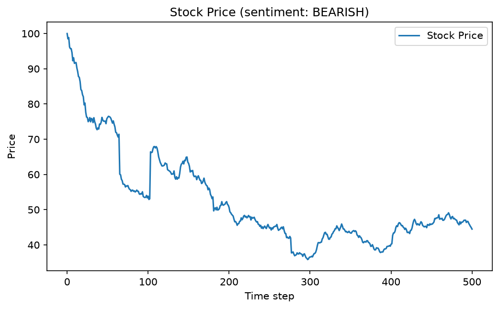
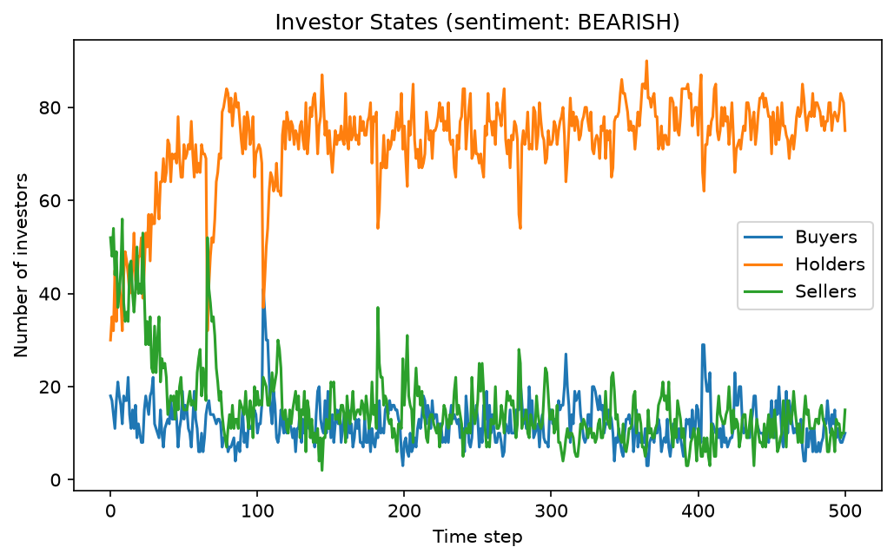
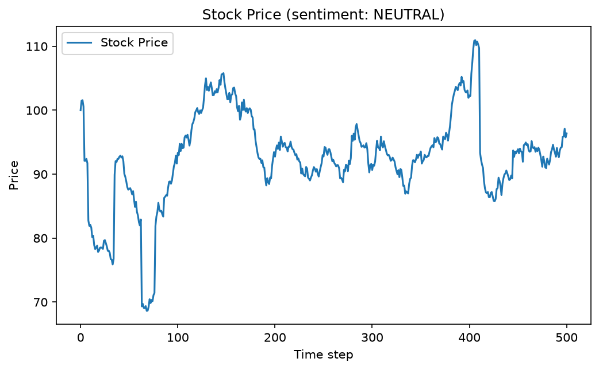
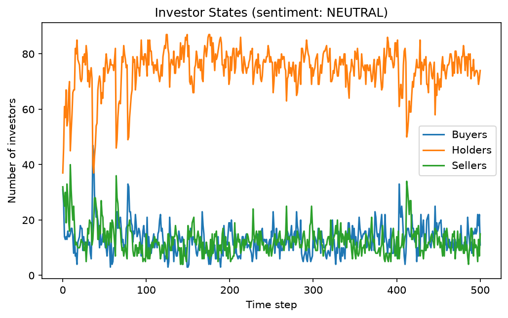
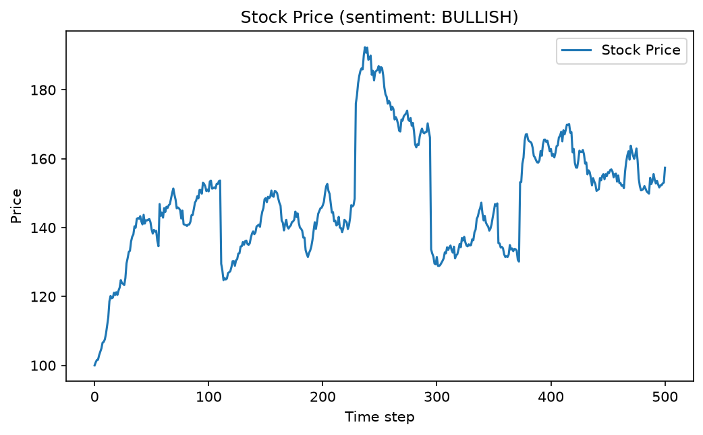
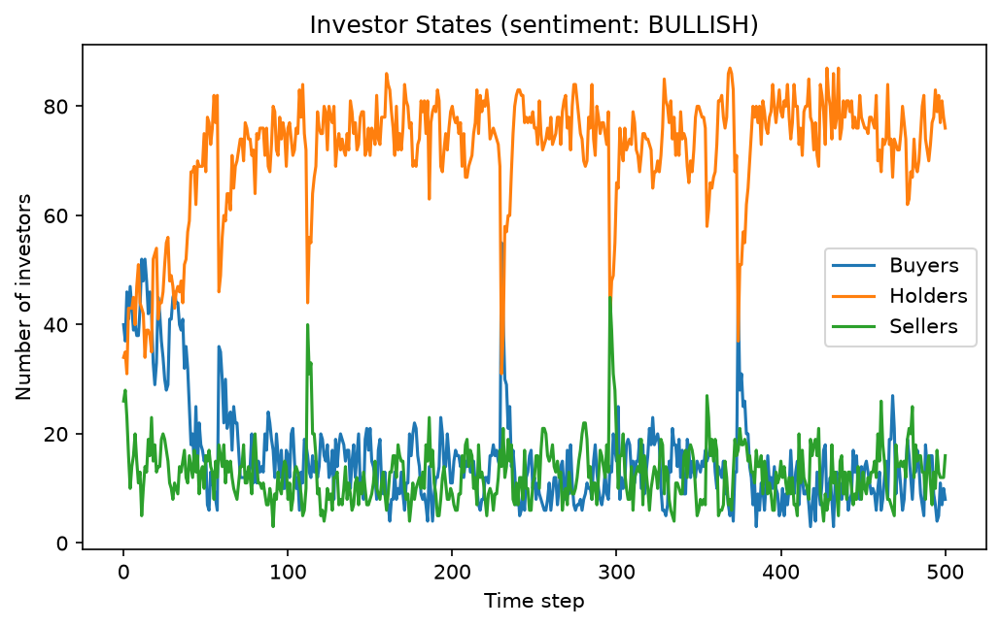
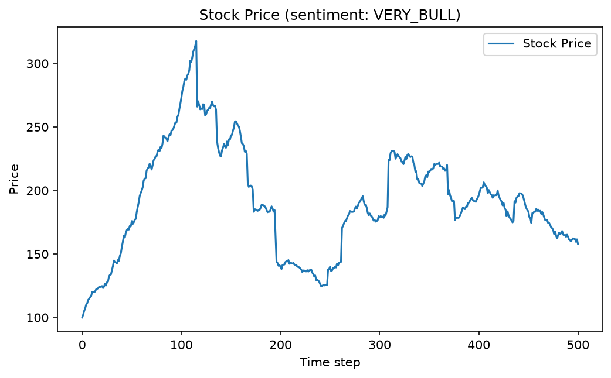
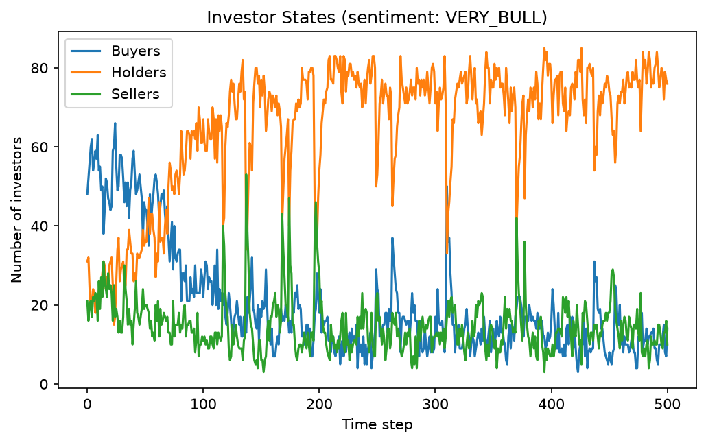

# Stock Rally/Crash Simulator

[](https://github.com/rramboer/stock-simulator/actions/workflows/ci.yml)
[](https://www.python.org/downloads/)
[](LICENSE)
[](https://github.com/astral-sh/ruff)

Agent-based Monte Carlo simulator of what a social event does to a stock price. A run starts just after a story has swept through a crowd of investors — a short squeeze, a "this coin is going to zero" narrative — and shows how fear-of-missing-out (FOMO), panic, and herding turn that one-sided sentiment into a rally or a crash, and what is left once the story fades.

## How it works

The market is 100 investors, each holding shares and carrying a sentiment in `[-1, 1]`. Sentiment above `+0.333` makes an investor a buyer, below `-0.333` a seller, and anything in between a holder. Everyone starts with their sentiment nudged toward the event's **narrative** (`--sentiment`), and then every time step:

1. **Trading** — each investor trades with the next `--trades` investors in a randomly shuffled order. Shares only move from a seller to a buyer: the seller parts with a fraction of their holdings equal to the average of the buyer's bullishness and the seller's bearishness, so any buyer/seller pair trades and the most convinced pairs trade the most. The total share count is conserved. Traded volume is recorded but does not move the price by itself.
2. **Sentiment updates** — each investor then:
   - drifts by a small random amount (private news), which keeps the crowd from collapsing into unanimity;
   - **FOMO**: with probability `--fomo-threshold`, chases the last price move, gaining `0.1` sentiment per percentage point (a 3% move adds 0.3). A move recruits more of the crowd, which moves the price further;
   - **panic**: with probability `--panic-prob`, flips to the opposite camp (sentiment × −0.66);
   - **otherwise follows the narrative**: with probability 0.2, moves 80% of the way toward the event's sentiment. The narrative's pull halves every `--narrative-half-life` steps, so the story eventually stops recruiting;
   - optionally leans against how far the price has strayed from its start (`--value-pull`, off by default).
3. **Price move** — the price changes by `4% × (buyers − sellers) / investors`, plus 1% Gaussian noise. With probability `--shock-prob` an unrelated shock rescales the price by a factor between 1/1.25 and 1.25, uniform in log space so shocks carry no drift.

Every move is a percentage, so a run's percent trajectory does not depend on the starting price. With the defaults the FOMO feedback gain sits just below one: a trend sustains itself only while the narrative keeps feeding it, and once the story fades the price keeps whatever level it reached rather than being pulled back. That is deliberate — plenty of squeezed and doomed stocks never came back — and `--value-pull` adds a mean-reverting force if you want bubbles to pop and crashes to be bought.

The run ends after `--steps` steps, or early if the price ever reaches zero (the defaults cannot produce that).

### Typical outcomes

Medians over 16 seeds of 500 steps with the defaults. "Peak" and "trough" are the best and worst prices along the way, relative to the start.

| `--sentiment` | Peak | Trough | Final | Final range across seeds |
| --- | --- | --- | --- | --- |
| `VERY_BEAR` | +0% | −82% | −74% | −93% … −54% |
| `BEARISH` | +0% | −65% | −50% | −88% … −13% |
| `NEUTRAL` | +29% | −34% | −10% | −79% … +67% |
| `BULLISH` | +111% | −2% | +62% | −64% … +217% |
| `VERY_BULL` | +321% | +0% | +238% | −34% … +485% |

## Example output

One run per preset, each from a fixed seed so the charts are reproducible. The seeds were chosen to land near the median outcome for their preset (see the table above), not for drama. Each pair shows the price and the buyer/holder/seller counts for the same run.

### `VERY_BEAR` — a doom narrative (`--seed 42`)

| Price | Investors |
| --- | --- |
|  |  |

Sellers outnumber buyers more than two to one at the start. Each drop recruits more sellers through FOMO and the price loses about 70% in the first 80 steps. As the narrative fades the crowd goes quiet — mostly holders, with brief flare-ups on shocks — and the price drifts around its new level, finishing near −79%.

### `BEARISH` (`--seed 12`)

| Price | Investors |
| --- | --- |
|  |  |

A milder story. Sellers still lead, but by less, so the decline is slower and shallower: about −64% at the low near step 300, settling around −56%.

### `NEUTRAL` (`--seed 9`)

| Price | Investors |
| --- | --- |
|  |  |

No story to follow. Buyers and sellers stay roughly balanced and the price wanders, dipping about 30% around step 70 before recovering to end near −4%. Every move here comes from noise, shocks, and short-lived FOMO flurries.

### `BULLISH` (`--seed 14`)

| Price | Investors |
| --- | --- |
|  |  |

The crowd leans bullish and FOMO does the rest: the price roughly doubles by step 240 and holds most of it, ending near +57%.

### `VERY_BULL` — a squeeze (`--seed 5`)

| Price | Investors |
| --- | --- |
|  |  |

Buyers outnumber sellers more than two to one at the start (48 to 21). FOMO compounds each rise: the price is up 76% by step 50 and 173% by step 100, and peaks at +218% on step 115. By then the narrative's pull has halved twice, and panic flips and shocks take over: the price gives back more than half of the peak by step 200, bottoms around +25% near step 240, and ends near +58% — well above where it started, a long way below the top. Pass `--value-pull 0.1` to see the same event unwind all the way back.

### Regenerating the example charts

By default the CLI writes `price_chart.png` and `investor_chart.png` in the current directory; those names are gitignored so experiments never clobber the committed examples. This regenerates all five pairs:

```sh
for pair in VERY_BEAR:42 BEARISH:12 NEUTRAL:9 BULLISH:14 VERY_BULL:5; do
  sentiment=${pair%:*}; seed=${pair#*:}; name=$(echo "$sentiment" | tr '[:upper:]' '[:lower:]')
  uv run stock-simulator --sentiment "$sentiment" --seed "$seed" \
    --price-chart "price_chart_$name.png" --investor-chart "investor_chart_$name.png"
done
```

Runs are randomized, so your charts will differ from the committed examples unless you pass `--seed`. Charts are always written headlessly with matplotlib's Agg backend — no display is needed, and no window is opened.

## Installation

Requires Python 3.12+ and [uv](https://docs.astral.sh/uv/). matplotlib is the only runtime dependency.

```sh
git clone https://github.com/rramboer/stock-simulator.git
cd stock-simulator
uv sync
```

## Usage

```sh
uv run stock-simulator [options]
```

A seeded example run:

```console
$ uv run stock-simulator --sentiment VERY_BEAR --seed 42
Current Price: 21.14
Percent Change (DAILY): -0.46%
Percent Change (ALL TIME): -78.86%
Saved charts to price_chart.png and investor_chart.png
```

| Option | Meaning | Default |
| --- | --- | --- |
| `--sentiment` | Narrative sentiment of the social event the run starts just after: `VERY_BEAR`, `BEARISH`, `NEUTRAL`, `BULLISH`, or `VERY_BULL` (mapped to −1 … 1) | `VERY_BEAR` |
| `--narrative-half-life` | Steps for the narrative's pull on sentiment to halve; `inf` for a story that never fades | `50` |
| `--investors` | Number of investors in the market | `100` |
| `--trades` | Distinct counterparties each investor trades with per step; `0` disables trading | `5` |
| `--fomo-threshold` | Per-step probability that an investor chases the last price move, in `[0, 1]` | `0.5` |
| `--panic-prob` | Per-step probability that an investor flips to the opposite camp, in `[0, 1]` | `0.2` |
| `--shock-prob` | Per-step probability of an exogenous shock that rescales the price by a factor in `[1/1.25, 1.25]` | `0.025` |
| `--value-pull` | Sentiment lost per step per unit of `ln(price / start)`; `0` lets a repriced stock stay repriced, around `0.1` makes squeezes collapse | `0` |
| `--steps` | Maximum number of time steps; stops early if the price reaches zero | `500` |
| `--seed` | Random seed for a reproducible run | unseeded |
| `--price-chart` | Output path for the price chart PNG | `price_chart.png` |
| `--investor-chart` | Output path for the investor chart PNG | `investor_chart.png` |
| `--verbose` | Also print end-of-run market statistics (holdings, average sentiment, buyer/holder/seller counts) | off |

Out-of-range values are rejected with a usage error. Two more parameters live in `SimulationConfig` (`src/stock_simulator/simulation.py`) rather than on the CLI: the starting price (`100.0`, which only scales the chart since every move is a percentage) and the total number of shares (`100,000`). The model's remaining constants — the noise levels, FOMO gain, panic damping, herding strength, and price impact — are named and documented at the top of that file. The simulation is also usable as a library:

```python
import random
from stock_simulator import Simulation, SimulationConfig, SENTIMENT_SKEWS

sim = Simulation(
    SimulationConfig(sentiment_skew=SENTIMENT_SKEWS["BULLISH"], narrative_half_life=30),
    rng=random.Random(42),
)
prices = sim.run(500)
sim.buyers, sim.holders, sim.sellers  # per-step state counts, aligned with prices
sim.volume_history  # shares traded per step
```

## Project structure

- `src/stock_simulator/` — the package: `simulation.py` (the model), `plotting.py` (headless chart rendering), `cli.py` (argparse entry point)
- `tests/` — pytest suite (rule-level tests with scripted random draws, model invariants, a pinned golden trajectory, statistical direction checks, CLI smoke tests)
- `price_chart_<sentiment>.png`, `investor_chart_<sentiment>.png` — committed example charts used above, one pair per preset

## Development

```sh
uv sync                  # install dependencies (including dev tools)
uv run ruff check .      # lint
uv run ruff format .     # format
uv run pytest            # run the test suite
```

CI runs the same checks plus a headless chart-generation smoke test on Python 3.12, 3.13, and 3.14 for every pull request and every push to `master`.

## License

MIT — see [LICENSE](LICENSE).
